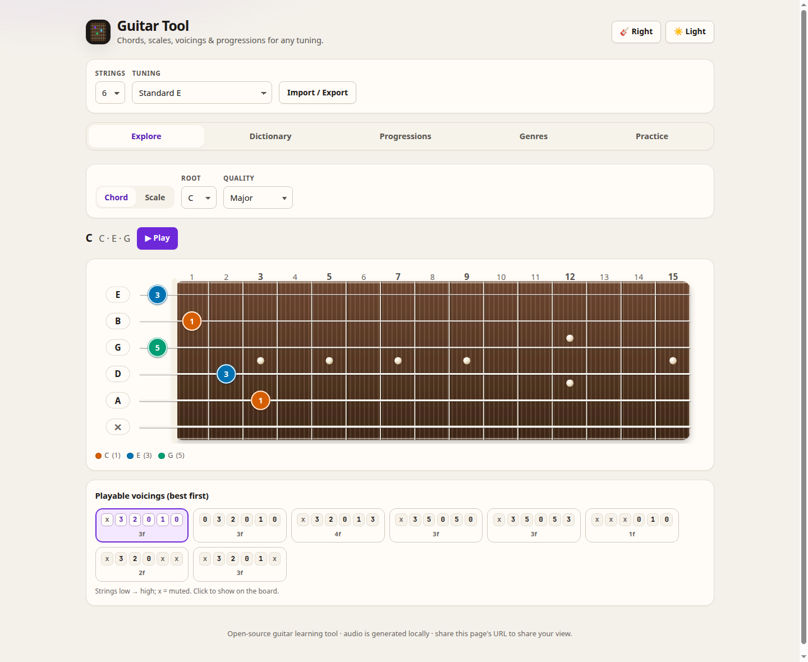

# Guitar Tool

**[Try it live →](https://dgluchowski.github.io/guitar-tool/)**

Guitar Tool is a free guitar learning app that runs entirely in the browser. It draws chords, scales, and voicings on a fretboard for standard and alternate tunings, plays them with audio generated on your device, and includes a tuner, a note trainer, and ear-training quizzes. No account and no uploads.



## Features

- **Explore.** Pick a chord, a scale, or identify a grip by clicking frets. Chords are searched in zones from the open strings through the top of a 24-fret neck, and you can filter them to a triad, a 4-string grip, a shell voicing, or the low, middle, or high strings. Scales can be limited to a root-relative box or a three-notes-per-string position. Flat keys and flat tunings are spelled with flats.
- **Dictionary.** Browse common chord qualities, with an optional set of advanced qualities, or switch to the seven diatonic chords of a major or minor key. Play chords one at a time, or layer them.
- **Progressions.** Start from a preset (I–V–vi–IV, I–IV–V, ii–V–I, the 1950s progression, i–♭VII–♭VI–V, or a 12-bar blues) or edit Roman numerals yourself. Play the progression in an open, mid, or high neck zone, or with smooth voice leading, and show each chord on the fretboard.
- **Genres.** Learning paths for the nine verified genres: blues, rock, folk, jazz, metal, funk, math rock, djent, and alternative metal. Each path collects tunings, scales, voicings, progressions, and short lessons.
- **Practice.**
  - **Tuner.** Microphone pitch detection down to the low E of an 8-string, auto string matching or a locked string, a cents meter, and an input-gain control. Audio stays on the device.
  - **Note trainer.** Play the pitch class shown (natural notes, or the full chromatic set), or tap it on the fretboard. Limit the drill to a string and fret window. Optional fretboard hint, plus score and best streak.
  - **Ear training.** Higher or lower, interval recognition, chord quality, and scale degree. Each exercise has easy, medium, and hard questions, and the relevant controls (direction, arpeggio, or a reference tonic). Best streaks are saved in the browser.
  - **Metronome.** A click from 40 to 240 BPM, tap tempo, and 4/4, 3/4, 6/8, 5/4, or 7/8, with the current beat lit.
- **Tunings.** 6-string presets (standard E, drop D, drop D♭, drop C, DADGAD, FACGCE, open G, open D, open E, half-step down, and D standard), 7-string presets (standard B, Drop A, and high A), and 8-string presets (standard F♯ and Drop E), or a custom string set. Tunings can be copied and pasted back in.
- **Around the app.** Left-handed fretboard, light and dark theme, and a URL hash that restores the current view so a link can be shared.
- **Installable.** A progressive web app with an offline cache of the built site. A GitHub Actions workflow publishes the build to GitHub Pages.

## Tech stack

- [React](https://react.dev/) 19 and [TypeScript](https://www.typescriptlang.org/)
- [Vite](https://vite.dev/) 8
- [Tailwind CSS](https://tailwindcss.com/) 4
- [Tonal](https://github.com/tonaljs/tonal) for chords, scales, and note spelling
- [Tone.js](https://tonejs.github.io/) for playback
- [pitchy](https://github.com/ianprime0509/pitchy) for microphone pitch detection
- [vite-plugin-pwa](https://vite-pwa-org.netlify.app/) for the installable offline shell
- [Vitest](https://vitest.dev/) and ESLint

## Run it

Node.js 20 or newer.

```bash
npm install
npm run dev
```

Vite prints a local URL, usually http://localhost:5173.

```bash
npm test          # unit tests
npm run lint      # ESLint
npm run build     # typecheck and production build
npm run preview   # serve the production build
```

`node scripts/gen-icons.mjs` regenerates the PNG icons in `public/` from `public/app-icon.svg`.

## Project structure

```
src/
  App.tsx           tabs, theme, handedness, and the shareable URL
  main.tsx          entry, plus a reload when an updated service worker takes over
  index.css         Tailwind and a few global styles
  components/       fretboard and the Explore, Dictionary, Progressions, Genres, and Practice views
  hooks/            microphone pitch hook
  data/             genre learning paths (genres.json)
  utils/            note and chord logic, playback, tuning import/export, ear-training questions, URL state
public/             favicon and PWA icons
scripts/            icon generator
.github/workflows/  test, build, and GitHub Pages deploy
```
